```
basheer@github ~ $ ./contributions.sh
```

<p align="center">
  
</p>

```
basheer@github ~ $ whoami
```

<table>
  <tr>
    <td valign="top" width="48%"></td>
    <td valign="top" width="52%"></td>
  </tr>
</table>
